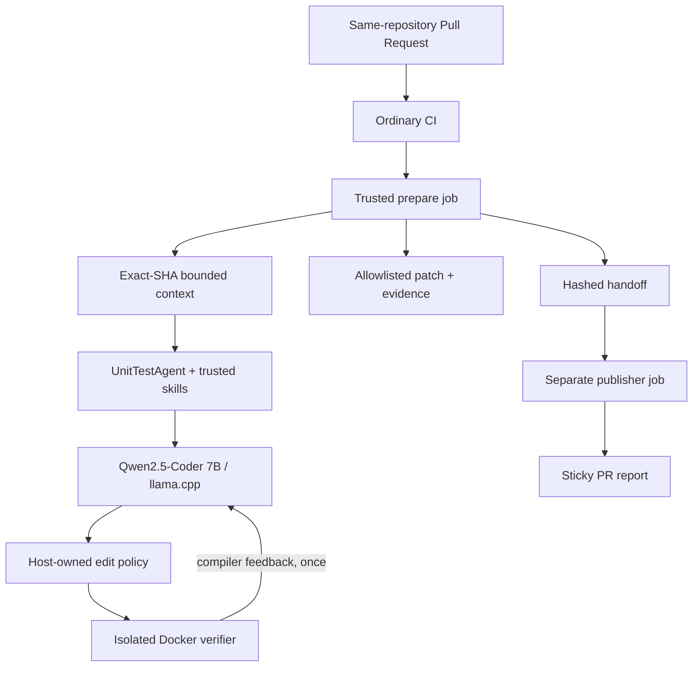

# Taskly — Unit Test Agent Solution

## Overview

This solution implements a GitHub-native **custom unit-test agent with reusable skills** for the existing React/TypeScript frontend and Python/FastAPI backend.

The main design goal was to keep the end-to-end prototype **self-contained and zero-cost**: no paid LLM API, no model API key, and no paid runner are required. The agent uses a pinned open-source Qwen model through a pinned `llama.cpp` runtime on a standard GitHub-hosted Ubuntu runner.

The model is intentionally **advisory**. Trusted host code owns source identity, context collection, allowed paths, skills, edit policy, test execution, final status, artifacts, and publication. A model proposal can be policy-accepted without being considered correct; only independent execution can produce a verified result.

| Area | Result |
| --- | --- |
| Custom agent + reusable skills | ✅ Implemented and exercised |
| Frontend + backend PR analysis | ✅ Implemented and exercised |
| Automatic GitHub PR workflow | ✅ Implemented and exercised |
| Real local-model inference in GitHub Actions | ✅ Demonstrated |
| Host policy + isolated verification | ✅ Implemented and exercised |
| Sticky PR reporting + patch artifact | ✅ Demonstrated |
| Existing-app coverage uplift | ✅ Merged to `main` and green in hosted CI |
| Fully repaired mixed-stack `VERIFIED` live demo | ⚠️ Not demonstrated in the final PR run |

Current default branch: `main` at `5cee6dde91df8ee45f7ab4cafbcaf073da1ba658`. [Ordinary CI run 38615945070](https://github.com/kreshby/cloudfide-test-agent/actions/runs/38615945070) passes frontend typecheck/tests/coverage and backend tests/coverage on that exact commit.

---

## Architecture and main technical decisions

Key decisions:

- **One custom agent, not a multi-agent framework.** The LLM is only one bounded component; orchestration and authority stay deterministic and auditable.
- **Staged inference:** `decision → edits → optional frontend repair`. The CPU benchmark showed that one monolithic request was too slow and brittle.
- **Exact source binding.** Context, base/head/merge-base, policy identity, intended paths, and stage bindings are host-owned and revalidated.
- **Generated code never runs with GitHub write credentials.** The model has no shell, arbitrary filesystem/network, GitHub write tool, or publisher token.
- **Independent verification is authoritative.** Generated tests are typechecked/run in a restricted Docker verifier; failures cannot be turned into `VERIFIED` by model text.
- **Separate publisher boundary.** `prepare` is read-only; only the later `publisher` job receives narrowly scoped write permission for the owned PR comment.
- **Patch delivery instead of automatic branch writes.** The reviewer can inspect generated changes before applying them.

The current agent is bounded to **5 provider calls**, **1 frontend repair**, **600 seconds per call**, and **2,100 seconds of active inference time**.

Implementation: [`automation/test_agent/`](automation/test_agent/) and [`.github/workflows/test-agent.yml`](.github/workflows/test-agent.yml).

---

## Custom agent and reusable skills

The agent is defined in [`automation/test_agent/agent.py`](automation/test_agent/agent.py). The local provider/runtime is pinned in [`provider.py`](automation/test_agent/provider.py) and [`runtime.py`](automation/test_agent/runtime.py).

Skills are registered by trusted host code in [`automation/test_agent/skills.py`](automation/test_agent/skills.py). Each registry entry fixes the skill ID, version, repository path, target applicability, and SHA-256; the file is re-hashed when loaded.

| Skill | Version | Purpose |
| --- | --- | --- |
| `analyze-change` | 1.0.0 | decide whether changed behavior justifies test work |
| `frontend-unit-tests` | 1.3.0 | Vitest/RTL generation/update conventions |
| `backend-unit-tests` | 1.0.0 | pytest/FastAPI generation/update conventions |
| `verify-test-patch` | 1.0.0 | reusable verification guidance |

The final PR #2 report records actual loading of `analyze-change` for both targets, `frontend-unit-tests` 1.3.0, and `backend-unit-tests` 1.0.0. I do not claim `verify-test-patch` was loaded in that specific run because the report does not show it.

### Publisher boundary

The production workflow has separate jobs:

| Job | Responsibility | Permission shape |
| --- | --- | --- |
| `prepare` | context, model, policy, verifier, artifact/handoff preparation | read-only |
| `publisher` | revalidate handoff/head and create/update one owned PR report | read + scoped PR/issues write |

Top-level permissions are empty. The publisher downloads only the current run's hashed handoff, rechecks source identity, and updates one sticky comment identified by an owned hidden marker. Model output and generated tests never receive its token.

---

## Model selection and $0 runtime

Three quantized candidates were tested on GitHub-hosted CPU runners before selecting the production runtime.

| Candidate | Initial hosted result | Task-specific score | Peak RSS | Decision |
| --- | --- | ---: | ---: | --- |
| Qwen3 4B Q4_K_M | completed | 5/50 | ~6.29 GB | too weak structurally/task-wise |
| Qwen3 8B Q4_K_M | timeout | 0/50 | ~9.75 GB | slower/heavier, no useful scored evidence |
| **Qwen2.5-Coder 7B Q4_K_M** | partial before timeout | **30/50** | ~8.70 GB | **selected** |

Evidence: [run 38317258513](https://github.com/kreshby/cloudfide-test-agent/actions/runs/38317258513) and [`automation/benchmarks/README.md`](automation/benchmarks/README.md).

The `30/50` is a **small synthetic task/contract score**, not proof that generated application tests pass and not a general model-quality rating. A corrective R2 run with equal 512-token / 90-second bounds timed out for all candidates ([run 38320645069](https://github.com/kreshby/cloudfide-test-agent/actions/runs/38320645069)). Qwen2.5-Coder was selected because it produced the strongest useful structured/task evidence while fitting runner memory.

This deliberately avoids paid inference credentials. The trade-off is CPU latency; the trust and verification architecture does not depend on the chosen model backend.

---

## Verification before the live PR

Before relying on a live model run, the policy/verifier path was exercised independently with deterministic tests and Docker integration smoke.

The Docker smoke on source `b9dd41...` demonstrated:

- baseline frontend typecheck + **18 frontend tests** passed;
- baseline **21 backend tests** passed;
- a good synthetic two-stack CREATE patch reached **19 frontend / 22 backend tests**;
- deliberately broken frontend/backend patches were rejected as `VERIFICATION_FAILED`.

This separated verifier correctness from model quality and hosted-inference performance.

---

## Demo PR #2 — real GitHub run

The example feature PR is **[PR #2 — Add full-stack todo priority filtering](https://github.com/kreshby/cloudfide-test-agent/pull/2)**. It changes both stacks and intentionally contains no feature-test changes in its single feature commit.

Final evidence:

- source CI: [38397187600](https://github.com/kreshby/cloudfide-test-agent/actions/runs/38397187600) — success;
- agent run: [38603632986](https://github.com/kreshby/cloudfide-test-agent/actions/runs/38603632986);
- sticky report: [PR #2 agent report](https://github.com/kreshby/cloudfide-test-agent/pull/2#issuecomment-6165325188).

| Stage | Observed result |
| --- | --- |
| Frontend decision | `generate` |
| Backend decision | `update` |
| Frontend CREATE / backend UPDATE | produced; accepted by host policy |
| Frontend baseline | typecheck + **18/18 tests passed** |
| Backend verifier baseline | **15/15 passed** |
| Frontend structural validation | passed |
| Patched frontend typecheck | failed |
| Compiler feedback → repair path | reached |
| Fifth Qwen repair call | started, then timed out |
| Final result | fail-closed; not `VERIFIED` |

The backend count is intentionally different from the ordinary **21-test** baseline: the backend proposal updated `backend/tests/features/todos/test_router.py`, which contains 6 tests, and the verifier excludes an UPDATE target from the baseline guard. Patched backend execution was not reached because verification stopped at the earlier frontend typecheck failure.

### Live-demo boundary

The final run demonstrated real PR triggering, both stack decisions, real model-generated CREATE/UPDATE proposals, trusted skill loading, host-policy acceptance, isolated verification, compiler-error detection, repair routing, artifact delivery, and PR publication.

The generated frontend test was **not correct enough to pass TypeScript verification**, and the verifier correctly stopped it instead of reporting false success. Repair then started a fifth real Qwen call. The first four CPU calls had consumed about **1,911.9 s of the 2,100 s active budget**, leaving only ~188 s; the repair timed out.

A faster inference backend would remove the **observed repair-timeout bottleneck**, but it would not guarantee model correctness. Independent verification remains authoritative.

---

## Existing application tests and coverage improvement

A final application-hardening pass added six missing unit-test cases and was fast-forwarded into `main`. These tests were authored separately from the PR runtime agent, so they are **not presented as agent-generated output**. They follow the same project conventions encoded in the trusted frontend/backend skills: isolated QueryClient/API-boundary behavior on the frontend and pytest/mocked repository behavior on the backend.

### Added tests

Frontend — `useCreateTodoMutation.test.tsx`:

1. calls `todosApi.create` with the supplied input;
2. cancels an in-flight todo-list query and caches the saved todo;
3. replaces a cached todo with the same ID without leaving a duplicate.

Backend — `test_repository.py`:

1. `create()` add/commit/refresh + mapped result;
2. `update()` applies supplied fields + commit/refresh + mapped result;
3. `delete()` deletes the existing record, commits, and returns `True`.

### Measured result

| Metric | Before | After | Change |
| --- | ---: | ---: | ---: |
| Frontend tests | 18 | **21** | +3 |
| Frontend statements | 46.42% | **50.59%** | +4.17 pp |
| Frontend functions | 40.25% | **46.75%** | +6.50 pp |
| Frontend lines | 47.68% | **51.65%** | +3.97 pp |
| Backend tests | 21 | **24** | +3 |
| Backend total coverage | 42% | **56%** | +14 pp |
| Backend `repository.py` | 40% | **91%** | +51 pp |

Hosted confirmation: [Ordinary CI 38615945070](https://github.com/kreshby/cloudfide-test-agent/actions/runs/38615945070).

---

## How to run the PR workflow

### Prerequisites

- public GitHub repository with Actions enabled;
- trusted workflow installed on `main`;
- same-repository PR targeting `main`;
- successful `Ordinary CI` run;
- standard `ubuntu-24.04` hosted runner;
- no external LLM API key.

The prototype is intentionally **bound to the trusted repository identity** (`kreshby/cloudfide-test-agent`) in both the workflow and host orchestration. To deploy the same design in another repository/fork, update that trusted identity in `.github/workflows/test-agent.yml` and `automation/test_agent/workflow.py` before enabling Actions. Fork-origin PR inference is intentionally disabled in this prototype.

### Automatic flow

1. Open/update a same-repository PR to `main`.
2. `Ordinary CI` runs the application checks.
3. `workflow_run` starts the test-agent workflow after CI completes.
4. `prepare` validates source identity, collects bounded context, runs agent/skills, validates edits, and runs the verifier.
5. One bounded frontend compiler-repair attempt may run when eligible.
6. `publisher` validates the handoff/head again and creates or updates the sticky PR report.

Manual `workflow_dispatch` can reprocess an exact completed pull-request CI `run_id`.

---

<strong>Branch strategy</strong>

The remote branches reflect isolated development stages rather than separate competing implementations:

- `main` — trusted integration line; current final application tests are included;
- `test-agent-workflow` — historical agent/workflow development line;
- `demo/fullstack-priority-filter` — intentionally separate feature-only demo PR;
- `fix/t07-live-boundaries` — historical live-boundary hardening;
- `fix/t07-b8-qwen-repair` — historical repair-path work;
- `coverage-improvement` — final coverage branch, now at the same commit as `main`.

This kept the demo input stable while security/reliability changes remained independently reviewable.

---

## Assumptions and limitations

**Assumptions**

- the supported live path is a same-repository PR against trusted `main`;
- repository/PR code and text are untrusted input, not configuration;
- existing Vitest/RTL and pytest stacks remain authoritative;
- generated patches remain reviewable output rather than automatic branch writes.

**Known limitations**

- the final mixed-stack live demo did not complete a repaired `VERIFIED` patch;
- CPU-only 7B inference is slow on the standard hosted runner;
- only one bounded frontend compiler repair is implemented; backend repair is not;
- Docker is practical isolation for this assignment, not VM/microVM-grade isolation;
- passing tests cannot prove semantic usefulness of every generated assertion; human review remains valuable;
- the model benchmark is small and task-specific.

---

## Production extensions

For production I would keep the host-authoritative architecture and improve the runtime around it:

- GPU/self-hosted or managed inference with the same provider boundary;
- per-stage inference budgets and prompt/context caching;
- VM/microVM-grade generated-code execution;
- abuse-controlled fork support on an unprivileged path;
- stronger semantic/mutation-style quality checks;
- optional automatic writeback only after policy + verifier success and explicit repository permissions;
- broader model evaluation across more repositories/scenarios.

---

## Evidence

- Repository: <https://github.com/kreshby/cloudfide-test-agent>
- Demo PR #2: <https://github.com/kreshby/cloudfide-test-agent/pull/2>
- Final demo agent run: <https://github.com/kreshby/cloudfide-test-agent/actions/runs/38603632986>
- Sticky PR report: <https://github.com/kreshby/cloudfide-test-agent/pull/2#issuecomment-6165325188>
- Final `main` CI: <https://github.com/kreshby/cloudfide-test-agent/actions/runs/38615945070>
- Model selection evidence: [`automation/benchmarks/README.md`](automation/benchmarks/README.md)
- Agent/verification evidence: [`automation/test_agent/README.md`](automation/test_agent/README.md)
- Baseline: [`docs/baseline/T01.md`](docs/baseline/T01.md)
